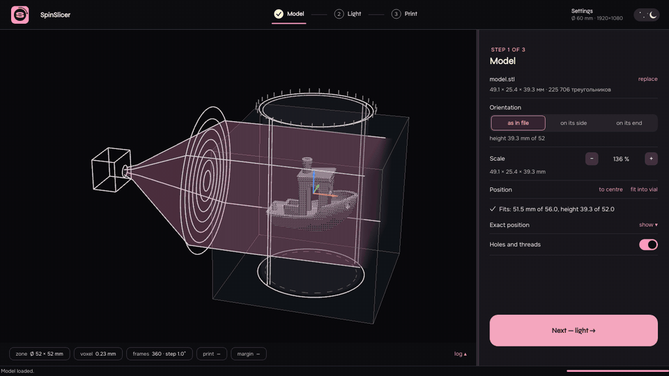

<p align="center">
  
</p>

<h1 align="center">SpinSlicer</h1>

<p align="center">
  Software local para fabricación aditiva volumétrica tomográfica (VAM).
</p>

<p align="center">
  <a href="README.md"></a>
  <a href="README.ru.md"></a>
  <a href="README.zh-CN.md"></a>
</p>

<p align="center">
  <a href="https://github.com/redbluecarrot/SpinSlicer/releases/latest"></a>
  <a href="https://github.com/redbluecarrot/SpinSlicer/releases"></a>
  <a href="LICENSE"></a>
  
  <a href="https://github.com/redbluecarrot/SpinSlicer/stargazers"></a>
</p>

<p align="center">
  
</p>

<p align="center">
  <a href="https://github.com/redbluecarrot/SpinSlicer/releases/latest"><b>Descargar</b></a> ·
  <a href="https://redbluecarrot.github.io/SpinSlicer/"><b>Página del proyecto</b></a>
</p>


SpinSlicer prepara impresiones para la fabricación aditiva volumétrica tomográfica
(VAM / CAL): un vial de resina gira frente a un proyector y la luz de cientos de
ángulos se suma para curar la pieza entera a la vez. SpinSlicer calcula esos
fotogramas a partir de un STL, muestra lo que curarán y los proyecta durante
exactamente la exposición planificada.


Si SpinSlicer te resulta útil, una ⭐ en GitHub ayuda a que otros lo encuentren.

## Características

Versión 0.6.0 — consulta las [notas de la versión](docs/releases/v0.6.0.md) (en inglés y ruso).

- **Tres pasos:** *Modelo* (cargar, colocar y comprobar el STL), *Luz* (calcular los
  fotogramas) e *Impresión* (proyectar, guardar MP4 o PNG).
- **Motor FastCAL:** en un vial redondo todos los ángulos son ópticamente iguales; los
  rayos se trazan para un solo ángulo. El modelo incluye refracción, atenuación, pérdidas
  de Fresnel, el perfil de píxel y el cono de rayos del proyector y el giro durante cada fotograma.
- **Impresión virtual:** los fotogramas tal como los mostrará el proyector se convierten
  de nuevo en dosis; la pieza curada se ve en 3D junto al modelo, con el ajuste (IoU) y
  el margen de exposición.
- **Plan de impresión** (tiempo y vueltas) y **mapa de dosis** cuyo deslizador es la exposición.
- **Salida al proyector lista para imprimir:** fotogramas 1:1 en la pantalla nativa, una
  fila por capa, fotograma elegido por el reloj (sin deriva), brillo en vivo y parada
  automática al alcanzar la dosis.
- **Fluido en equipos modestos:** el cálculo corre en un proceso aparte usando todos los núcleos.
- **Interfaz en inglés y ruso**, temas claro y oscuro.

## Instalación y paquetes

### Paquetes precompilados (GitHub Releases)

Descarga los binarios desde [Releases](https://github.com/redbluecarrot/SpinSlicer/releases):

- **Windows 10 / 11:**
  - **Instalador:** descarga y ejecuta `SpinSlicer-Setup-0.6.0.exe`
  - **Portable:** descarga `SpinSlicer-windows-x64.zip`, extráelo y ejecuta `SpinSlicer.exe`
- **Arch Linux / Manjaro:**
  ```bash
  sudo pacman -U SpinSlicer-0.6.0-1-x86_64.pkg.tar.zst
  ```
- **Ubuntu / Debian / Mint:**
  ```bash
  sudo apt install ./SpinSlicer-0.6.0-amd64.deb
  ```
- **Fedora / RHEL / openSUSE:**
  ```bash
  sudo dnf install ./SpinSlicer-0.6.0-1.x86_64.rpm
  ```
- **Linux portable genérico:**
  ```bash
  tar -xzf SpinSlicer-linux-x64.tar.gz
  ./SpinSlicer
  ```

### Entorno de desarrollo desde el código fuente

SpinSlicer es compatible con Python 3.11 y 3.12.

```bash
python -m venv .venv
# Windows
.venv\Scripts\activate
# macOS/Linux
# source .venv/bin/activate

python -m pip install -r requirements.txt -r requirements-dev.txt
```

Ejecuta la aplicación con:

```bash
python SpinSlicer.py
```

## Modelos STL roscados

Carga la tuerca como un STL normal mediante **Load STL**. Los taladros internos
y el relieve de rosca se conservan por defecto durante la rasterización de
secciones, incluso con la opción de reparación de malla activada. Mantén el paso
y la profundidad de la rosca con varios vóxeles de ancho a la resolución de
malla elegida; ningún proyector basado en vóxeles puede representar de forma
fiable detalles demasiado pequeños.

## Backends de proyección

El motor de proyección sigue las mismas etapas conceptuales que Tomo y
VAMToolbox:

1. voxelizar la geometría objetivo;
2. generar u optimizar una secuencia de proyecciones sobre ángulos equiespaciados;
3. aplicar una escala común de proyección y exportar una secuencia de fotogramas para su reproducción.

El motor FastCAL traza rayos refractados según Snell, con pérdidas de Fresnel,
a través de un vial redondo (en aire o en un baño de inmersión), integra la
atenuación de Beer–Lambert y ajusta proyecciones no negativas para que la dosis
quede por encima del umbral de gelificación dentro de la pieza y por debajo
fuera. La rotación del vial hace el operador circulante por bloques, así que el
cálculo se reduce a FFT y productos matriciales por lotes con numpy/SciPy en
todos los núcleos de la CPU: no hace falta compilador ni GPU.

La previsualización reconstruye los valores de gris de los PNG exportados e
informa del RMSE de forma de la dosis relativa tras ajustar una escala común.
No es una predicción de curado calibrada. La
dispersión, la respuesta de curado del material y la dosis absoluta del hardware
requieren calibración adicional. Consulta el [modelo y las comprobaciones
reproducibles](docs/validation/engine-judge-2026-10-31.md).

## Formato de salida

Cada generación completada crea un directorio de ejecución único:

```text
output_frames/
└── run-20260903T120000Z-a1b2c3d4/
    ├── frame_0000.png
    ├── frame_0001.png
    ├── slice_meta.json
    ├── dose_stats.txt
    ├── reconstruction_dose.npy
    ├── reconstruction_target.npy
    ├── reconstruction_preview.png
    └── manifest.json
```

`manifest.json` almacena la identidad de la fuente (cuando es un STL), el tipo y
los parámetros del modelo, la matriz de transformación, el backend de
proyección, los ajustes de resina, las dimensiones de los fotogramas y
`complete: true`. El repositorio de fotogramas valida el número de imágenes,
dimensiones, metadatos, límites de bytes y estado de finalización antes de que
un reproductor pueda consumir una ejecución. Las carpetas planas heredadas con
`frame_*.png` siguen siendo legibles.

## Estructura del proyecto

| Archivo | Propósito |
| --- | --- |
| `spinslicer/app.py` (started by `SpinSlicer.py`) | Ventana principal, selector de idioma, barra de estado compartida y registro. |
| `assets/spinslicer.svg` | Icono de la aplicación para la interfaz y los paquetes. |
| `spinslicer/slicer_tab.py` | Carga y transformación de STL, e interfaz de generación de proyecciones. |
| `spinslicer/nut_dialog.py` | Diálogo heredado de tuerca roscada, conservado por compatibilidad de API. |
| `spinslicer/threaded_nut.py` | Generador paramétrico heredado de tuercas, conservado por compatibilidad de API. |
| `spinslicer/ui_panels.py` | Ajustes de impresora/proceso y controles compactos de transformación del modelo. |
| `spinslicer/slicing_engine.py` | Rasterización de secciones, planificación de proyecciones y exportación PNG verificada. |
| `spinslicer/optics/` | Motor FastCAL, rayos de Snell y la matriz de referencia exacta con la que los tests comprueban FastCAL. |
| `spinslicer/video_tab.py` | Reproducción de fotogramas y exportación a MP4. |
| `spinslicer/frame_io.py` | Almacenamiento validado de conjuntos de fotogramas, metadatos y manifiestos. |
| `spinslicer/profiles.py` | Ajustes validados de máquina y resina registrados con cada ejecución. |
| `spinslicer/validation.py` | Comprobación previa de malla/recursos y presupuestos de carga. |
| `spinslicer/model_node.py` | Malla original y estado de transformación apto para GPU. |
| `spinslicer/viewport.py` | Visor 3D con PyVista/VTK. |
| `spinslicer/workers.py` | Workers Qt en segundo plano para carga de modelos, generación y vídeo. |
| `spinslicer/synthetic_shapes.py` | Fantomas canónicos para validación numérica. |
| `tests/` | Pruebas de geometría, proyección, almacenamiento, seguridad y validación. |

## Validación y seguridad

Antes de generar, SpinSlicer comprueba la finitud de la malla, el número de
triángulos, los límites, el ajuste a la cubeta, el número de capas, la memoria
estimada, las dimensiones de los fotogramas y los presupuestos de salida. Las
tareas largas se ejecutan en workers `QThread` y admiten cancelación. Los
directorios de salida solo se confirman cuando todos los archivos PNG y los
metadatos superan la validación. Las rutas locales se abren mediante la API de
escritorio de Qt, no con un comando de shell.

## Comprobaciones de desarrollo

```bash
python -m pytest
python -m ruff check .
python -m mypy
```

GitHub Actions ejecuta las mismas comprobaciones en cada push y pull request.

## Versiones

Para publicar compilaciones de escritorio descargables, actualiza la versión en
`pyproject.toml` y crea y sube la etiqueta de versión correspondiente:

```bash
git tag vX.Y.Z
git push origin vX.Y.Z
```

El workflow `Build release artifacts` publica los archivos en la [página de
GitHub Releases](https://github.com/redbluecarrot/SpinSlicer/releases):

- `SpinSlicer-windows-x64.zip` — contiene `SpinSlicer.exe` para Windows de 64 bits;
- `SpinSlicer-Setup-<version>.exe` — instalador de Windows por usuario con accesos directos en el menú Inicio y, opcionalmente, en el escritorio;
- `SpinSlicer.exe` — ejecutable independiente de Windows;
- `SpinSlicer-linux-x64.tar.gz` — ejecutable portable de Linux de 64 bits;
- `SpinSlicer-<version>-amd64.deb` — paquete Debian/Ubuntu;
- `SpinSlicer-<version>-1.x86_64.rpm` — paquete compatible con Fedora/RHEL.

En Linux, descomprime el archivo y ejecuta `chmod +x SpinSlicer && ./SpinSlicer`.
También puedes instalar el paquete nativo con `sudo apt install ./SpinSlicer-<version>-amd64.deb`
o `sudo dnf install ./SpinSlicer-<version>-1.x86_64.rpm`. Ambos paquetes añaden
`SpinSlicer` al menú de aplicaciones. Las compilaciones de Linux son para x86_64.

## Referencias científicas

- [Tomo — Print Preparation Software](https://opencal-org.readthedocs.io/en/stable/software/tomo/)
- [Documentación de VAMToolbox](https://vamtoolbox.readthedocs.io/en/latest/)
- [Repositorio de VAMToolbox](https://github.com/computed-axial-lithography/VAMToolbox)
- [Automatic Exposure Volumetric Additive Manufacturing](https://doi.org/10.1002/admt.202402168)

El artículo del DOI describe la VAM tomográfica y el control automático de
exposición mediante retroalimentación de luz dispersa en tiempo real.
SpinSlicer solo implementa por ahora la generación de proyecciones y la
previsualización de fotogramas; la retroalimentación por hardware para la
exposición automática queda fuera del alcance de este prototipo de escritorio.
