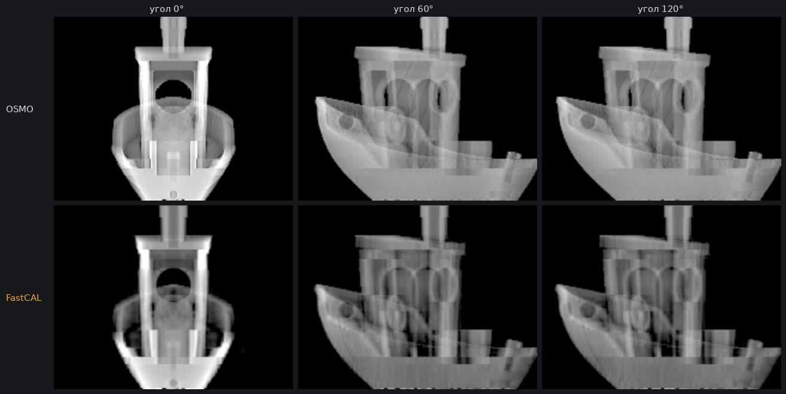
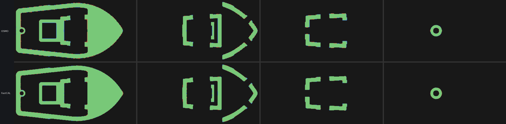
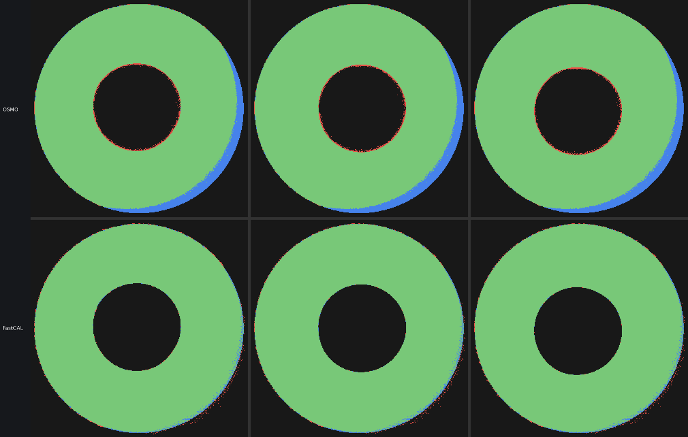
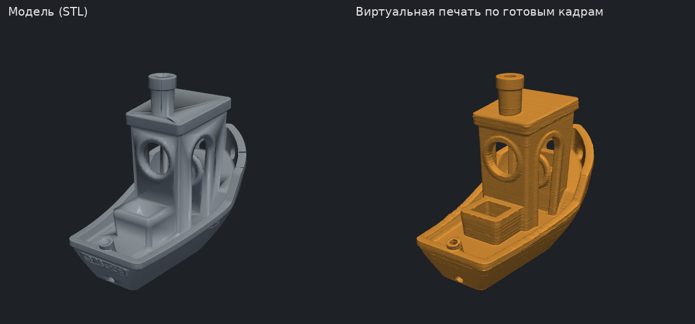

# FastCAL vs OSMO (2026-10-30)

OSMO (Rackson et al., VAMToolbox `minimizeOSMO`) is the reference optimiser for CAL
printing. This page compares it with FastCAL on the same jobs. Reproduce on any model with
`python tools/compare_osmo.py model.stl --grid 128` (grid 256 needs about 6 GB for the judge).

## Set-up

- Same target, same optics for both engines: refraction in a 60/56 mm round vial,
  attenuation off, 360 frames, grid 256. OSMO runs its verbatim update rule (50 iterations,
  d_h 0.8, d_l 0.7, ram-lak filtered target) on SpinSlicer's exact Siddon operator, so it
  models refraction too.
- **Judge:** the exact Cartesian Siddon operator on a 2× finer 512 grid, applied to 8-bit
  frames, against a target voxelised independently at 512. Neither engine plans on that
  grid, so neither is judged by its own model.
- **Machine:** 2 CPU cores, 7 GB RAM, no GPU.

## Do the frames look alike?

Correlation between FastCAL and OSMO frames at every angle:

| Model | Mean | Worst angle |
| --- | ---: | ---: |
| threaded nut, immersion | 0.79 | 0.76 |
| threaded nut, vial in air | 0.80 | 0.61 |
| stress model (gear, rings, pins) | 0.90 | 0.87 |
| 3DBenchy | 0.86 | 0.82 |

The two engines give the same kind of frames: an "X-ray" of the part with bright silhouette
edges. Both show horizontal steps where the part changes with height and thin vertical
stripes. Frame similarity alone cannot rank engines, because many different frame sets give
the same dose. What decides a print is the cured part, below.

## What prints

| Model | Engine | Time | IoU | Wrong voxels | Exposure window | VER | VER, core |
| --- | --- | ---: | ---: | ---: | ---: | ---: | ---: |
| nut, immersion | **FastCAL** | **10.7 s** | **0.9946** | **0.19 %** | 4.0 % | 0.031 | **0.0066** |
| | OSMO | 175 s | 0.9898 | 0.36 % | **4.1 %** | **0.021** | 0.0150 |
| nut, air | **FastCAL** | **10.3 s** | **0.9816** | **0.66 %** | **+0.5 %** | **0.033** | **0.030** |
| | OSMO | 189 s | 0.9293 | 2.53 % | −13.9 % | 0.130 | 0.121 |
| stress model | **FastCAL** | **5.3 s** | **0.9895** | **0.19 %** | **8.9 %** | **0.020** | **0.015** |
| | OSMO | 68 s | 0.9786 | 0.39 % | 3.9 % | 0.048 | 0.027 |
| Benchy | **FastCAL** | **10.0 s** | **0.9816** | **0.14 %** | **9.0 %** | **0.017** | **0.010** |
| | OSMO | 149 s | 0.9672 | 0.26 % | 7.4 % | 0.724 | 0.048 |

Column notes:
- **IoU** and **wrong voxels** are taken at the best single exposure.
- **Exposure window** is the gap between the 0.5 % dimmest in-part voxels and the 0.5 %
  brightest out-of-part voxels, measured away from partial edge voxels.
- **VER** is VAMToolbox's voxel error rate: void voxels at or above the dimmest gel voxel.
- **VER, core** is the same as VER without the voxels the model surface cuts in half.

On the index-matched nut, OSMO's lower plain VER comes only from those half-covered edge
voxels. FastCAL deliberately places them at intermediate dose, so the cured surface lands
inside the voxel where the mesh is. Away from them, FastCAL's VER is 2.3× lower. Peak RAM
was 0.36–0.56 GB for FastCAL and 0.66–1.17 GB for OSMO.

Benchy cross-sections cured from each engine's frames (green = right, red = extra,
blue = missing): both are clean.

In an air vial, OSMO leaves a crescent of uncured resin on the side of the part beyond
r = 20 mm. Refraction limits which rays reach that region, and FastCAL's band objective
still fills it.

## Will it survive a real machine?

Twelve virtual prints per job, each with a different random set of errors:
- projector blur: 0.7 row and 0.5 pixel;
- exposure: ±5 %;
- axis offset: ±0.1 mm;
- per-frame timing jitter: ±1°.

Mean and worst IoU on the 512 judge:

| Model | FastCAL mean / worst | OSMO mean / worst |
| --- | ---: | ---: |
| nut, immersion | **0.979 / 0.962** | 0.976 / 0.959 |
| nut, air | **0.968 / 0.953** | 0.912 / 0.896 |
| stress model | **0.937 / 0.904** | 0.868 / 0.852 |
| Benchy | **0.958 / 0.941** | 0.934 / 0.899 |

FastCAL comes out ahead on every model.

## Without a printer: the virtual print

The slicer runs the same check on every job, without the 512 judge. It takes the saved
frames as displayed (8-bit values, gamma, contrast), computes the dose in the whole volume
and builds the cured part. The **Virtual print** button shows that part. The print plan
also reports how much the part grows or shrinks if the exposure is 5 % off.

## All engines: FastCAL, OSMO, BCLP, SIRT

BCLP is the VAMToolbox `minimizeBCLP` optimiser (Li, Toombs, Taylor 2024), run with its
default options on the same exact operator:
- generalized logistic response B 25, band eps 0.1, p 2, q 1;
- projected gradient descent from a ram-lak start;
- two settings: the default 50 iterations (step 0.01, the best of a sweep), and 200
  iterations with step 0.005 to give it the best result we found.

SIRT is the friend's v0.4.0 fork in maximum mode, with and without its dose window.

Judge and robustness test are the same as above. The robustness test was run only for
FastCAL, OSMO and the 200-iteration BCLP. Flicker is the mean change of a frame between
neighbouring angles, relative to the mean frame.

| Model | Engine | Time | RAM | IoU | Wrong voxels | Window | VER core | Robust mean / worst | Flicker |
| --- | --- | ---: | ---: | ---: | ---: | ---: | ---: | ---: | ---: |
| nut, imm | **FastCAL** | **10.7 s** | **0.45 GB** | **0.9946** | **0.19 %** | 4.0 % | **0.007** | **0.979** / 0.962 | **0.02** |
| | OSMO | 175 s | 1.1 GB | 0.9898 | 0.36 % | **4.1 %** | 0.015 | 0.976 / 0.959 | 0.06 |
| | BCLP 50 | 151 s | 1.6 GB | 0.9656 | 1.24 % | −8.3 % | 0.40 | — | 0.67 |
| | BCLP 200 | 553 s | 1.6 GB | 0.9736 | 0.94 % | −3.6 % | 0.33 | 0.977 / **0.970** | 0.60 |
| | SIRT + window | 45 s | 1.6 GB | 0.9808 | 0.69 % | +0.6 % | 0.10 | — | 0.12 |
| | SIRT | 33 s | 1.6 GB | 0.9405 | 2.17 % | −9.3 % | 0.28 | — | 0.19 |
| nut, air | **FastCAL** | **10.3 s** | **0.56 GB** | **0.9816** | **0.66 %** | **+0.5 %** | **0.030** | **0.968 / 0.953** | **0.03** |
| | OSMO | 189 s | 1.2 GB | 0.9293 | 2.53 % | −13.9 % | 0.12 | 0.912 / 0.896 | 0.04 |
| | BCLP 50 | 146 s | 1.7 GB | 0.7158 | 13.6 % | −99 % | 0.48 | — | 0.64 |
| | BCLP 200 | 598 s | 1.7 GB | 0.8064 | 8.23 % | −67 % | 0.39 | 0.822 / 0.790 | 0.63 |
| | SIRT + window | 50 s | 1.7 GB | 0.9666 | 1.20 % | −3.8 % | 0.09 | — | 0.13 |
| | SIRT | 34 s | 1.7 GB | 0.8559 | 5.70 % | −35 % | 0.21 | — | 0.21 |
| stress model | **FastCAL** | **5.3 s** | **0.34 GB** | **0.9895** | **0.19 %** | **8.9 %** | **0.015** | 0.937 / 0.904 | 0.09 |
| | OSMO | 68 s | 0.66 GB | 0.9786 | 0.39 % | 3.9 % | 0.027 | 0.868 / 0.852 | **0.08** |
| | BCLP 50 | 42 s | 0.89 GB | 0.9577 | 0.79 % | −2.0 % | 0.10 | — | 0.68 |
| | BCLP 200 | 144 s | 0.90 GB | 0.9681 | 0.59 % | +4.1 % | 0.11 | **0.949 / 0.937** | 0.68 |
| | SIRT + window | 18 s | 0.96 GB | 0.9414 | 1.10 % | −7.1 % | 0.08 | — | 0.22 |
| | SIRT | 12 s | 0.96 GB | 0.8274 | 3.29 % | −135 % | 0.28 | — | 0.39 |
| Benchy | **FastCAL** | **10.0 s** | **0.37 GB** | **0.9816** | **0.14 %** | **9.0 %** | **0.010** | **0.958 / 0.941** | **0.06** |
| | OSMO | 149 s | 0.88 GB | 0.9672 | 0.26 % | 7.4 % | 0.048 | 0.934 / 0.899 | 0.08 |
| | BCLP 50 | 64 s | 1.1 GB | 0.9297 | 0.57 % | +2.3 % | 0.47 | — | 0.57 |
| | BCLP 200 | 229 s | 1.1 GB | 0.9470 | 0.42 % | +6.6 % | 0.43 | 0.928 / 0.916 | 0.57 |
| | SIRT + window | 27 s | 1.2 GB | 0.9138 | 0.68 % | −16.5 % | 0.23 | — | 0.12 |
| | SIRT | 19 s | 1.2 GB | 0.7627 | 2.00 % | −92 % | 0.36 | — | 0.23 |

What the table shows:
- **Without perturbations**, FastCAL is the most accurate and the fastest in every case.
- **Under projector blur and machine errors**, BCLP holds up best on fine features: on the
  stress model it has the best mean and worst IoU, and on the nut in immersion the best
  worst case.
- **Why:** FastCAL plans pin-sharp dose edges, so its frames lose more when the projector
  blurs them. BCLP's soft response band leaves margin.
- **Next step:** make FastCAL plan with the projector's blur in its model.
- **Caveat:** BCLP was built for GPUs at 512 px. This CPU port keeps its algorithm and
  defaults, but its step size is hand-picked, so it may do better when tuned per job.

## Projector blur (2026-10-30)

On the stress model the blur that hurts is the one between frame rows: rows are layers,
and the model changes abruptly with height.

| Blur (σ, rows / pixels) | FastCAL | FastCAL, pre-sharpened for σ = 0.7 row | BCLP 200 | OSMO |
| --- | ---: | ---: | ---: | ---: |
| none | **0.990** | 0.959 | 0.968 | 0.979 |
| 0 rows / 0.5 px | **0.989** | — | 0.971 | 0.977 |
| 0.7 rows / 0 px | 0.960 | **0.981** | 0.957 | 0.891 |
| 1.0 rows / 0 px | 0.909 | **0.953** | 0.921 | — |

Table values are IoU on the 512 judge with the projector blur applied to the frames.

`optics/presharpen.py` pre-sharpens the frames along rows for a known blur σ: it finds the
nonnegative frames that the projector blurs back into the planned ones, using 8 FISTA
iterations, about 3 s for 432 rows. The slicer setting is **Projector blur σ, mm**; 0 means
off. Overestimating σ costs accuracy (first row of the table), so σ must come from a
measurement. The virtual print and the print plan apply the same blur model to what the
projector shows.

Benchy in the app with σ = 0.15 mm (1.8 rows), by virtual print:
- sharp projector: 98.80 %;
- blurred, frames not compensated: 98.22 %;
- blurred, frames pre-sharpened: 98.58 %.
